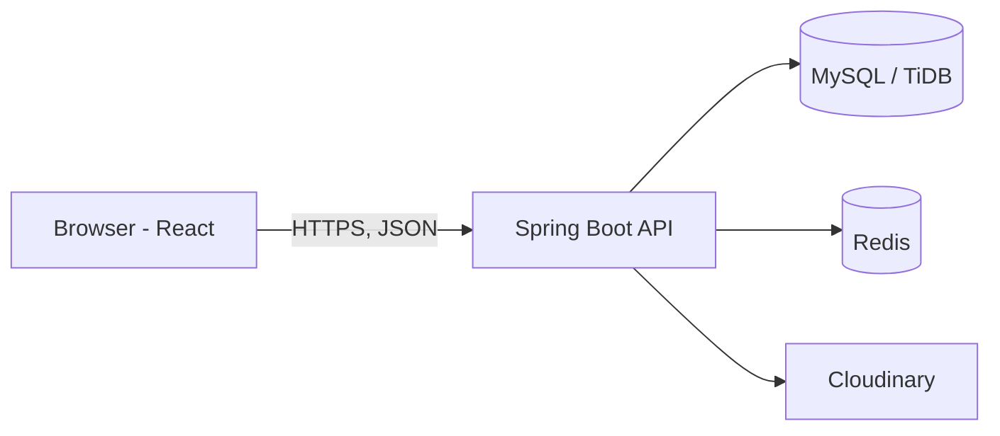

# LocalKart

A hyperlocal, multi-vendor e-commerce platform. Local shops (kirana, medical, bakery and more) list their products online, and nearby customers discover stores by location and fill a cart.

**Live demo:** https://localkart-java.onrender.com
**API:** https://localkart-java-backend.onrender.com/actuator/health

> The demo runs on free hosting tiers. If the site has been idle, the first request can take up to a minute while the server wakes up.

## Features

**Customer**
- Register, login, and a silent session refresh
- Discover nearby approved stores by GPS or area search, with distance shown
- Browse a store, search products, view a multi-image gallery
- Single-store cart with quantity limits and stock checks, and a "replace cart" flow when switching stores
- Profile photo, log out from all devices, delete account

**Store owner**
- Create a store with a map-based location picker (address and pincode auto-filled)
- Open and close the store, edit details, upload a logo
- Manage products (1 to 5 images each), update stock, low-stock highlight
- Deleting a product hides it from customers (soft delete)

**Admin**
- Approve or reject new stores
- Block or unblock users with a reason
- Review unblock appeals (assigned-to-me and all-appeals views)

## Security highlights

- Passwords hashed with BCrypt
- Short-lived JWT access token (15 min) plus a rotating refresh token in an httpOnly cookie. Only a SHA-256 hash of the refresh token is stored in the database
- Refresh token reuse detection, absolute 24-hour session, server-side logout
- Role-based access (CUSTOMER, STORE_OWNER, ADMIN) with method-level guards, plus ownership checks so one owner cannot edit another owners data
- Redis-backed rate limiting per IP and a login lock per email (5 failed attempts)
- A blocked user token stops working immediately
- Image uploads are validated by file signature, size-limited, and stored on Cloudinary; the secret never reaches the browser
- Secrets are read from environment variables, not committed

## Tech stack

| Layer | Technology |
|---|---|
| Backend | Java 17, Spring Boot, Spring Security, Spring Data JPA, Bean Validation |
| Database | MySQL (local), TiDB Cloud Starter (production) |
| Cache and limits | Redis (Docker locally, Upstash in production) |
| Frontend | React (Vite), Redux Toolkit, React Router, Tailwind CSS, React Hook Form, Zod, Leaflet |
| Media | Cloudinary |
| Deployment | Docker, Render (backend and static frontend) |

## Architecture



Backend layout:

```
backend/src/main/java/com/example/backend/
├── controller/   REST endpoints
├── service/      business rules
├── repository/   Spring Data JPA
├── model/        JPA entities
├── dto/          request and response objects
├── security/     JWT filter, rate limiting, cookies
└── exception/    global error handling
```

## API overview

Base path: `/api/v1`

| Area | Endpoints |
|---|---|
| Auth | `POST /auth/register`, `/auth/login`, `/auth/refresh`, `/auth/logout`, `/auth/appeals`, `/auth/appeals/status` |
| Users | `GET /users/me`, `POST /users/me/photo`, `DELETE /users/me/photo`, `DELETE /users/me`, `DELETE /users/me/sessions` |
| Stores | `GET /stores/nearby`, `POST /stores`, `GET /stores/me`, `PUT /stores/me`, `PATCH /stores/me/open` |
| Products | `GET /stores/{id}/products`, `/owner/products` (create, list, update, stock, delete) |
| Cart | `GET /cart`, `POST /cart/items`, `PATCH /cart/items/{productId}`, `DELETE /cart/items/{productId}`, `DELETE /cart` |
| Uploads | `POST /uploads/image` |
| Admin | `/admin/stores`, `/admin/users`, `/admin/appeals` |

## Run locally

**Prerequisites:** JDK 17, Node 20 or newer, MySQL 8, Redis (Docker is fine), a Cloudinary account.

```bash
# 1. Database
mysql -u root -p -e "CREATE DATABASE localkart CHARACTER SET utf8mb4;"

# 2. Redis
docker run -d --name localkart-redis -p 6379:6379 redis:7
```

**Backend:** create `backend/.env` (see `backend/.env.example`; never commit it):

```properties
DB_URL=jdbc:mysql://localhost:3306/localkart?useSSL=false&serverTimezone=UTC&allowPublicKeyRetrieval=true
DB_USER=root
DB_PASSWORD=your_password
JWT_SECRET=a-random-string-of-at-least-32-characters
CLOUDINARY_CLOUD_NAME=...
CLOUDINARY_API_KEY=...
CLOUDINARY_API_SECRET=...
```

```bash
cd backend
./mvnw spring-boot:run      # Windows: .\mvnw spring-boot:run
```

**Frontend:** create `frontend/.env`:

```properties
VITE_API_BASE_URL=http://localhost:8080/api/v1
```

```bash
cd frontend
npm install
npm run dev
```

Log out and log in again so the new role is picked up.

## Deployment

- **Backend:** Docker image built from `backend/Dockerfile`, deployed as a Render web service
- **Database:** TiDB Cloud Starter (MySQL compatible, TLS required)
- **Redis:** Upstash
- **Frontend:** Render static site, with `https://localkart-java.onrender.com` set at build time
- **Environment variables:** `DB_URL`, `DB_USER`, `DB_PASSWORD`, `JWT_SECRET`, `CLOUDINARY_*`, `REDIS_HOST`, `REDIS_PORT`, `REDIS_PASSWORD`, `REDIS_SSL`, `COOKIE_SECURE`, `COOKIE_SAME_SITE`, `CORS_ORIGIN`

Note: the frontend and API are on different subdomains, so the refresh cookie is cross-site (`SameSite=None; Secure`). Some browsers restrict third-party cookies; a custom domain with `app.` and `api.` subdomains avoids this.

## Author

**Sarthak Shastrakar**, <<LinkedIn link>>, <<email>>
